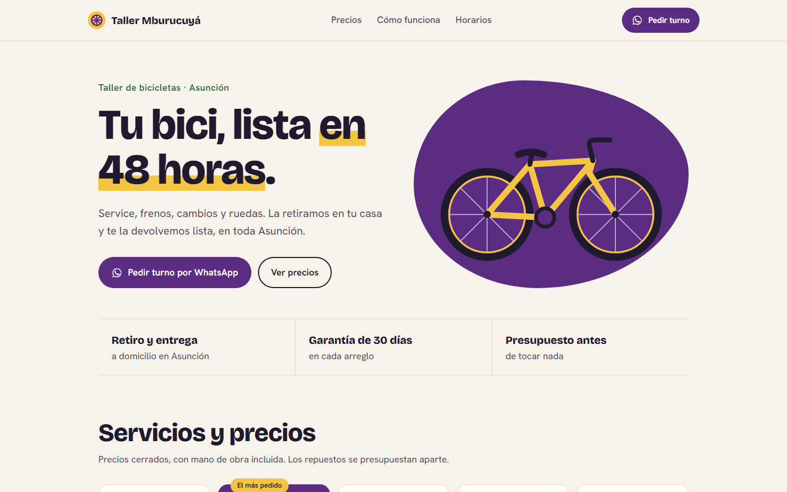
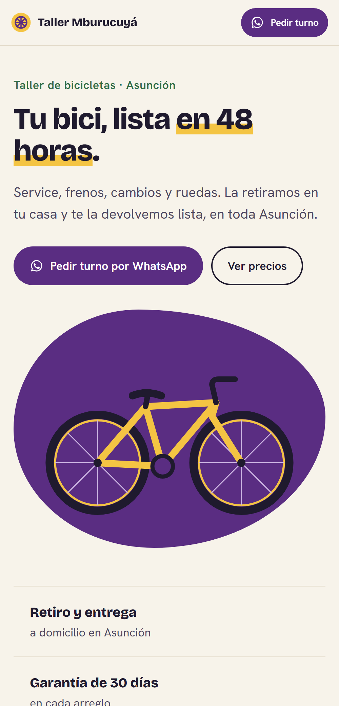

# Landing page para un taller de bicicletas

[](https://github.com/nandres/landing-taller-bicicletas/actions/workflows/ci.yml)

Muestra de trabajo: **el negocio es ficticio**. Una sola página con servicios, precios cerrados, horarios, preguntas frecuentes y un botón para pedir turno por WhatsApp.

**Demo:** https://demo-taller-mburucuya.vercel.app

| Escritorio | Celular |
|---|---|
|  |  |

En esta muestra el botón no abre WhatsApp; en la versión real abre el chat con el mensaje listo.

## Stack

React 19 y Vite, sin librerías de interfaz. Se publica como sitio estático en Vercel.

## Correrlo

```bash
npm ci
npm run dev
```

```bash
npm run build
```

## Licencia

Software propietario: ver [LICENSE](LICENSE).

Hecho por **Marcos Arellano** · [marcos-arellano.vercel.app](https://marcos-arellano.vercel.app)
